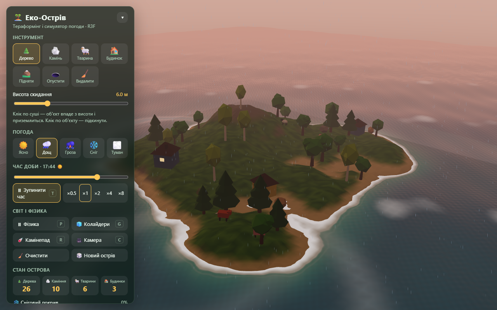

# 🏝️ Інтерактивний Еко-Острів — 3D Terraforming & Weather Simulator

Інтерактивна 3D-сцена острова, створена в межах курсу
**«Відтворення 3D елементів та просторів у веб-середовищі з використанням THREE.JS та R3F»**.
Користувач змінює погоду й час доби, перебудовує рельєф, висаджує й прибирає об'єкти
(дерева, каміння, тварин, будинки) і спостерігає за фізикою довкілля.



## Запуск

```bash
npm install
npm run dev       # дев-сервер Vite
npm run build     # перевірка типів + продакшн-збірка в dist/
npm run preview   # перегляд збірки
npm test          # модульні тести (Vitest)
npm run typecheck # перевірка типів TypeScript (tsc)
npm run lint      # ESLint (typescript-eslint) + правила React Hooks / React Compiler
```

Потрібен Node.js 20+.

## Що вміє сцена

| Вимога | Реалізація |
| --- | --- |
| **Системи частинок** | Дощ і сніг — GPU-частинки з власним шейдером (9 000 + 5 000 точок; позиції рахує вершинний шейдер через `mod()`, з JS оновлюється лише `uTime`). Світлячки вночі — `Sparkles` з drei. Туман — `FogExp2`, густина залежить від погоди |
| **Фізика (@react-three/rapier)** | Об'єкти падають з заданої висоти на колайдер-карту висот рельєфу (`HeightfieldCollider`). Каміння котиться (опукла оболонка), дерева й будинки не перекидаються. У воді діє сила Архімеда: дерева, тварини й будинки плавають і їх зносить вітром, каміння тоне. Тварини стрибають імпульсами й оминають воду |
| **Procedural Terrain** | Острів із fBm simplex-шуму з радіальною маскою. Пензлем можна піднімати/опускати рельєф у реальному часі — геометрія, кольори, колайдер і береги на воді оновлюються |
| **Water Shader** | Хвилі (сума спрямованих синусоїд, висота залежить від вітру й грози), брижі від кліків, падінь об'єктів і швидкого руху камери, піна біля берега за текстурою глибин, френель від кута огляду камери, «рябизна» під дощем |
| **Raycasting** | Клік по суші висаджує об'єкт у точку перетину променя; приціл показує, чи придатне місце (вода, крутизна схилу). Поява — пружна анімація масштабу з обертом, приземлення — «сплющення», видалення — зменшення з обертом |
| **Погода й час доби** | 5 пресетів (ясно, дощ, гроза, сніг, туман) з плавним переходом. Сніг накопичується на рівних і високих поверхнях і тане; після дощу ґрунт темнішає й блищить; під час грози — блискавки. Цикл доби: сонце й місяць, зорі, вікна будинків світяться вночі, дерева ростуть під дощем |

### Керування

| Дія | Результат |
| --- | --- |
| Клік по суші (🌲 🪨 🐑 🏠) | Об'єкт падає з висоти скидання (повзунок) |
| Клік по воді | Брижі; з інструментом 🪨 камінь падає в море |
| Затиснута ЛКМ з ⛰️ / 🕳️ | Підняти / опустити рельєф (камера на цей час блокується) |
| Клік по об'єкту | Підкинути його (з 🧹 — видалити) |
| Перетягування / колесо / ПКМ | Обертання, масштаб і зсув камери |

Гарячі клавіші: `1`–`7` — інструменти, `W` — наступна погода, `T` — хід часу,
`P` — пауза фізики, `G` — показати колайдери, `R` — камінепад, `C` — скинути камеру.

## Технології

- **three** — рендеринг, власні GLSL-шейдери (`ShaderMaterial`, `onBeforeCompile`)
- **@react-three/fiber** — декларативний Three.js, цикл `useFrame`, події вказівника (raycasting)
- **@react-three/drei** — `OrbitControls`, `Sparkles`, `useCursor`, `AdaptiveDpr`
- **@react-three/rapier** — фізичний рушій Rapier (WASM)
- **simplex-noise** — процедурна генерація рельєфу
- **zustand** — глобальний стан
- **TypeScript** (strict), **Vite**, **Vitest**, **ESLint** (`typescript-eslint`, `eslint-plugin-react-hooks` з правилами React Compiler)

## Архітектура

```
src/
├── config.ts                  # усі константи: світ, рельєф, погода, палітри, типи об'єктів
├── App.tsx                    # Canvas + HUD
├── lib/                       # чиста логіка без React — покрита тестами
│   ├── terrain.ts             # карта висот, білінійна вибірка, нормалі, пензель, кольори
│   ├── environment.ts         # крок симуляції довкілля: погода, сніг, вологість, блискавки
│   ├── dayCycle.ts            # положення сонця, палітра неба за часом і хмарністю
│   ├── placement.ts           # перевірка місця, створення об'єктів, стартове наповнення
│   ├── physics.ts             # сила Архімеда
│   ├── animals.ts             # вибір напрямку стрибка
│   ├── ripples.ts             # кільцевий буфер брижів для шейдера води
│   └── math.ts, random.ts     # утиліти, детермінований ГПВЧ mulberry32
├── store/
│   ├── useIslandStore.ts      # zustand: інструмент, погода, об'єкти, версія рельєфу
│   └── runtime.ts             # transient-стан, що змінюється щокадру (довкілля, небо, брижі)
├── shaders/                   # GLSL: вода, небо, опади, погодний патч матеріалів
├── scene/
│   ├── Experience.tsx         # композиція сцени
│   ├── EnvironmentDriver.tsx  # «серце» симуляції: перший useFrame у кадрі
│   ├── Terrain.tsx            # меш + колайдер + raycasting + тераформінг
│   ├── BrushCursor.tsx        # приціл / радіус пензля
│   ├── Water.tsx, SkyDome.tsx, Lighting.tsx, CameraRig.tsx
│   ├── assets.ts              # спільні геометрії й матеріали
│   ├── terrainGeometry.ts     # побудова й часткове оновлення геометрії рельєфу
│   ├── entities/              # Entity (фізика + анімації), моделі, реєстр типів
│   └── weather/               # Precipitation, Fireflies, Clouds
├── hooks/                     # клавіатура, знімок довкілля для UI, useDisposable
└── ui/Hud.tsx                 # панель керування
```

### Ключові рішення

- **Розділення стану.** Реактивний стан (інструмент, погода, список об'єктів) — у zustand;
  компоненти підписуються вибірково. Те, що змінюється 60 разів на секунду (час доби, змішана погода,
  кольори неба, брижі), живе в `store/runtime.ts` і читається в `useFrame` без ре-рендерів.
  HUD бере знімок цього стану кілька разів на секунду (`useEnvironmentSnapshot`).
- **Одне джерело правди для рельєфу.** Карта висот `Float32Array` використовується геометрією,
  колайдером Rapier, текстурою глибин для води та логікою розміщення об'єктів. Пензель оновлює
  лише змінений прямокутник: позиції, нормалі (`gridNormal` із сусідніх висот замість
  `computeVertexNormals` по всій сітці), кольори, відрізки буферів на GPU (`addUpdateRange`)
  і ділянку текстури глибин води (`pendingTerrainEdit`). Колайдер — `HeightfieldCollider`
  (висоти транспонуються в column-major порядок Rapier, тріангуляція збігається з мешем —
  це перевіряє тест на справжньому Rapier); він перебудовується один раз наприкінці мазка
  (`terrainVersion`), після чого сплячі тіла «будяться».
- **Чиста логіка окремо від рендерингу.** Усе, що можна порахувати без WebGL, винесено в `lib/`
  і покрито модульними тестами (41 тест).
- **Спільні ресурси.** Геометрії й матеріали об'єктів створюються один раз (`assets.ts`);
  сніг і вологість — це патч `onBeforeCompile` зі спільними уніформами, тож одне присвоєння
  на кадр оновлює рельєф, дерева, дахи й каміння.
- **Явні колайдери.** Фізична форма кожного типу задана простими примітивами й не залежить
  від анімації масштабу візуальної частини.
- **Звільнення пам'яті GPU.** Геометрії, матеріали й текстури, створені компонентами, звільняються
  при демонтуванні (`useDisposable`, `useEffect` cleanup).
